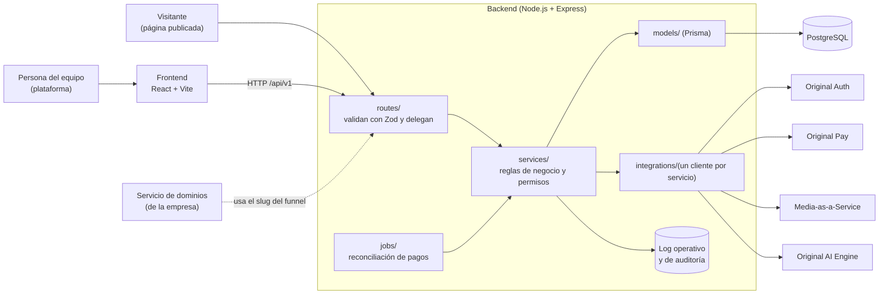
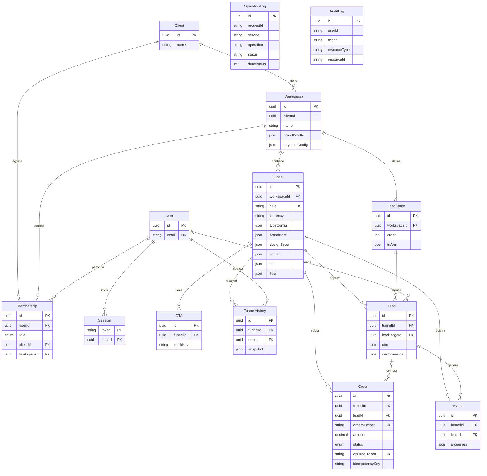

# Original Flow — Arquitectura

Mapa técnico del proyecto: cómo se organiza el sistema, el modelo de datos y el orden de construcción. Los contratos de cada endpoint están en `docs/API_MVP.md` y el contexto de negocio en `docs/PROJECT_CONTEXT.md`.

## Vista general



- El frontend **nunca** llama directo a un servicio de The Original Lab ni a un proveedor externo: todo pasa por el backend, que guarda las llaves.
- Un servicio de negocio nunca conoce HTTP (status, headers); devuelve un resultado plano a la ruta.
- Un trabajo programado (`jobs/`) entra directo al servicio, sin pasar por una ruta.
- El log operativo y el de auditoría están **pendientes de diseño** (ver «Pendientes»).

## Capas del backend

| Capa | Carpeta | Responsabilidad | Nunca hace |
| --- | --- | --- | --- |
| Rutas | `backend/src/routes/` | Recibe el request, valida la forma con Zod, delega y devuelve la respuesta | Lógica de negocio ni consultas a la base de datos |
| Servicios | `backend/src/services/` | Reglas de negocio y permisos por rol | Conocer HTTP |
| Modelos | `backend/src/models/` | Acceso a datos (cliente de Prisma y consultas por entidad) | Lógica de negocio |
| Esquemas | `backend/src/schemas/` | Validación de entrada y salida (Zod), incluida la forma de los campos JSON | Lógica de negocio |
| Integraciones | `backend/src/integrations/<servicio>/` | Clientes de Original Auth, Original Pay, Media-as-a-Service y Original AI Engine, con `client.ts`, `types.ts` y `config.ts` | Lógica de negocio propia |
| Tipos de funnel | `backend/src/funnel-types/` | El registro de definiciones (bloques base, CTA principal, esquema de `typeConfig`, conversión, si cobra) | Tocar la base de datos |
| Trabajos | `backend/src/jobs/` | Tareas programadas, como la reconciliación de pagos | Conocer HTTP |
| Middleware | `backend/src/middleware/` | Autenticación por grupo de rutas, CORS, encabezados de seguridad, límite de peticiones, `requestId` | Reglas de negocio |
| Configuración | `backend/src/config/` | Única lectura de variables de entorno | Cualquier otra cosa |

## Modelo de datos

PostgreSQL, 14 tablas. Todas llevan `id` (uuid, clave primaria) y `createdAt`, salvo que se indique otra cosa. Lo que cambia con frecuencia o depende del tipo de funnel se guarda como **JSON dentro de la fila** (marca, diseño, contenido, ajustes), para no crear tablas de páginas, bloques o plantillas.

Fuentes de verdad: `backend/prisma/schema.prisma` y sus migraciones (`backend/prisma/migrations/`), con Prisma 7. `docs/design/modelo-datos/schema.sql` es una copia de referencia de las migraciones. Las imágenes `ER 1` a `ER 5` de esa carpeta muestran el modelo (la 5 es la de los registros).

### Diagrama entidad-relación



### Reglas generales

- **Borrado:** eliminar un `Funnel` borra en cascada sus CTA, historial, leads y eventos. Un funnel con órdenes no se puede eliminar (la clave foránea de `Order` está en `Restrict`) para conservar el registro de los cobros; en ese caso solo se despublica. Un `Workspace` o un `Client` con funnels no se puede borrar sin eliminar antes lo que contiene.
- **Aislamiento:** toda consulta se filtra por el workspace de la persona; un recurso ajeno responde `404`.
- **JSON:** cada campo JSON se valida con Zod al escribir y se lee de forma defensiva (nunca un `JSON.parse` a secas).
- **Privacidad:** los datos de `Lead` son personales; no se escriben en los registros técnicos. No se guardan datos de tarjeta: la tokenización queda a cargo de Original Pay y la pasarela (PCI-DSS).
- **Dominios:** `Funnel` no tiene campos de dominio; solo el `slug`, que el servicio de dominios de la empresa usa para armar la URL.
- **Registros sin claves foráneas:** `OperationLog` y `AuditLog` guardan ids como texto, sin relación con las demás tablas, para que sobrevivan al borrado de usuarios, workspaces o funnels.
- **`AuditLog` es de solo lectura:** un disparador de PostgreSQL (migración `audit_log_inmutable`) rechaza cualquier `UPDATE` o `DELETE`; la aplicación solo inserta y consulta.

### Enumeraciones

| Enum | Valores |
| --- | --- |
| `MembershipRole` | `super_admin`, `client_admin`, `marketing_manager`, `vendedor`, `disenador`, `analista` |
| `MembershipStatus` | `invited`, `active` |
| `FunnelObjective` | `leads`, `venta`, `citas`, `magnet`, `webinar`, `aplicacion`, `upsell`, `libre` |
| `FunnelStatus` | `draft`, `published` |
| `CtaActionType` | `url`, `form_submit`, `scroll_to`, `checkout` |
| `LeadSource` | `web_form`, `whatsapp` |
| `OrderStatus` | `pending`, `paid`, `cancelled`, `failed` |

### Diccionario: cuentas, usuarios y marca

**Client**: el cliente de The Original Lab (tenant). Tiene uno o varios workspaces.

| Campo | Tipo | Req. | Descripción |
| --- | --- | --- | --- |
| `name` | texto | Sí | Nombre del cliente o empresa |

**User**: persona con acceso. Se crea la primera vez que Original Auth confirma su correo.

| Campo | Tipo | Req. | Descripción |
| --- | --- | --- | --- |
| `email` | texto único | Sí | Identidad que entrega Original Auth |
| `name` | texto | No | Nombre visible |

**Session**: sesión propia que respalda el flujo de Original Auth. Su token es el `Bearer` de la API. Su clave primaria es `token`.

| Campo | Tipo | Req. | Descripción |
| --- | --- | --- | --- |
| `token` | texto (clave) | Sí | UUID generado en `GET /auth/session` |
| `userId` | uuid | No | Se llena cuando el callback valida la sesión |
| `validated` | booleano | Sí | `true` una vez autenticado. Por defecto `false` |

**Membership**: conecta a un usuario con un cliente o un workspace según su rol.

| Campo | Tipo | Req. | Descripción |
| --- | --- | --- | --- |
| `userId` | uuid | No | Vacío mientras la invitación está pendiente |
| `invitedEmail` | texto | No | Correo invitado antes de que exista el usuario |
| `role` | enum | Sí | Uno de los 6 roles |
| `status` | enum | Sí | `invited` o `active` |
| `clientId` | uuid | No | Solo para `client_admin` |
| `workspaceId` | uuid | No | Para los roles de workspace. `super_admin` no lleva ninguno de los dos |

**Workspace**: una marca o unidad de negocio. Aquí vive la identidad visual que genera el onboarding y la conexión de pagos.

| Campo | Tipo | Req. | Descripción |
| --- | --- | --- | --- |
| `clientId` | uuid | Sí | Cliente al que pertenece |
| `name` | texto | Sí | Nombre de la marca |
| `country` | texto | No | País |
| `website` | texto | No | Sitio web actual |
| `industry` | texto | No | Rubro (cursos, ecommerce, servicios...) |
| `logoFileId` | texto | No | Id del logo en Media-as-a-Service |
| `brandPalette` | JSON | No | Paleta generada con IA y editable |
| `paymentConfig` | JSON | No | Conexión con Original Pay. La llave va cifrada y nunca se devuelve al frontend |

**LeadStage**: etapas del tablero de leads, configurables por workspace. Al crear el workspace se generan 5 por defecto.

| Campo | Tipo | Req. | Descripción |
| --- | --- | --- | --- |
| `workspaceId` | uuid | Sí | Workspace dueño del pipeline |
| `name` | texto | Sí | Ej. Nuevo, Contactado |
| `order` | entero | Sí | Posición en el tablero. Único por workspace |
| `isFinal` | booleano | Sí | Marca etapas de cierre (Cliente, Perdido) |
| `isWon` | booleano | Sí | Etapa a la que pasa un lead cuando paga. Por defecto `false`; la etapa «Cliente» la lleva en `true` |

### Diccionario: funnel, CTA e historial

**Funnel**: una página completa con su diseño, contenido y `slug`. Lo flexible es JSON en la misma fila.

| Campo | Tipo | Req. | Descripción |
| --- | --- | --- | --- |
| `workspaceId` | uuid | Sí | Marca a la que pertenece |
| `name` | texto | Sí | Nombre interno |
| `objective` | enum | Sí | Tipo de funnel |
| `status` | enum | Sí | `draft` o `published`. Por defecto `draft` |
| `language` | texto | Sí | Código de idioma. Por defecto `es` |
| `slug` | texto único | Sí | Nombre del funnel; el servicio de dominios lo usa para armar la URL |
| `productName` | texto | No | Producto o servicio |
| `price` | decimal | No | Precio (funnels de venta) |
| `currency` | texto | Sí | `MXN`, `USD` o `CLP`. Por defecto `MXN` |
| `targetAudience` | texto | No | Público objetivo |
| `typeConfig` | JSON | No | Ajustes propios del tipo de funnel |
| `brandBrief` | JSON | No | Respuestas del wizard sobre la marca |
| `designSpec` | JSON | No | Diseño generado: paleta, tipografías y estilo |
| `content` | JSON | Sí | Los bloques de la página. Por defecto `{"blocks":[]}` |
| `seo` | JSON | No | Título, descripción e indexación |
| `flow` | JSON | No | Nodos y conexiones para varias páginas. Vacío en el MVP |
| `updatedAt` | fecha | Sí | Última edición |

**CTA**: configuración de un botón o formulario. Se crea sola al agregar el bloque en `content` y se elimina con él.

| Campo | Tipo | Req. | Descripción |
| --- | --- | --- | --- |
| `funnelId` | uuid | Sí | Funnel al que pertenece |
| `blockKey` | texto | Sí | `key` del bloque dentro de `content`. Único por funnel |
| `label` | texto | Sí | Texto del botón |
| `actionType` | enum | Sí | `url`, `form_submit`, `scroll_to` o `checkout` |
| `destination` | texto | No | URL o destino |
| `trackingId` | texto | No | Identificador para medir clics |

**FunnelHistory**: cada versión guardada del funnel y quién la hizo.

| Campo | Tipo | Req. | Descripción |
| --- | --- | --- | --- |
| `funnelId` | uuid | Sí | Funnel versionado |
| `userId` | uuid | Sí | Usuario que guardó la versión |
| `label` | texto | No | Nombre de la versión |
| `snapshot` | JSON | Sí | Copia de `content`, `designSpec`, `brandBrief`, `seo` y `flow` en ese momento |

Restaurar una versión copia su `snapshot` de vuelta a las columnas del funnel y crea una entrada nueva en el historial, para poder deshacer.

### Diccionario: leads, órdenes y eventos

**Lead**: contacto capturado por un formulario.

| Campo | Tipo | Req. | Descripción |
| --- | --- | --- | --- |
| `funnelId` | uuid | Sí | Funnel de origen |
| `leadStageId` | uuid | Sí | Etapa actual; al crearse toma la primera del workspace |
| `name` | texto | No | Nombre |
| `email` | texto | No | Correo |
| `phone` | texto | No | Teléfono |
| `source` | enum | Sí | `web_form` o `whatsapp` |
| `utm` | JSON | No | `{ utm_source, utm_medium, utm_campaign, referrer }` |
| `assignedTo` | uuid | No | Usuario vendedor asignado |
| `value` | decimal | No | Valor estimado de la oportunidad |
| `customFields` | JSON | No | Respuestas de campos personalizados y contexto del visitante |

**Order**: un cobro hecho dentro de la página con Original Pay. Se crea antes de cobrar, en estado `pending`, y se actualiza cuando se confirma el pago.

| Campo | Tipo | Req. | Descripción |
| --- | --- | --- | --- |
| `publicToken` | uuid único | Sí | Lo que ve el comprador en la URL de retorno; no revela el id interno |
| `funnelId` | uuid | Sí | Funnel donde se compró |
| `leadId` | uuid | No | Lead que compra. Se vacía si el lead se elimina |
| `orderNumber` | texto único | Sí | Número propio; se envía a Original Pay como `order_number` |
| `amount` | decimal | Sí | Monto. Lo fija el servidor desde `Funnel.price`, nunca el navegador |
| `currency` | texto | Sí | `MXN`, `USD` o `CLP` |
| `status` | enum | Sí | `pending`, `paid`, `cancelled` o `failed` |
| `paymentMethod` | texto | No | stripe, paypal, mercadopago... |
| `opOrderToken` | texto único | No | `order_token` que devuelve Original Pay en `/payment/init` |
| `customerEmail` | texto | Sí | Correo del comprador; Original Pay lo usa para evitar órdenes duplicadas |
| `idempotencyKey` | texto | No | Valor del encabezado `Idempotency-Key` del checkout. Único por funnel (`funnelId` + `idempotencyKey`); reintentar con la misma clave devuelve la orden original sin cobrar otra vez |
| `paymentUrl` | texto | No | URL de pago que devuelve Original Pay |
| `gateway` | JSON | No | Respuesta resumida de la pasarela, para auditoría. Sin datos de tarjeta |
| `paidAt` | fecha | No | Cuándo se confirmó el pago |

**Event**: registro genérico de todo lo que ocurre; alimenta la analítica.

| Campo | Tipo | Req. | Descripción |
| --- | --- | --- | --- |
| `funnelId` | uuid | Sí | Funnel donde ocurrió |
| `leadId` | uuid | No | Lead asociado, si ya se conoce |
| `type` | texto | Sí | `page_view`, `section_view`, `button_click`, `form_submit`, `lead_created`, `checkout_started`, `payment_completed`, `conversion`... Texto libre para aceptar eventos propios |
| `properties` | JSON | No | Datos del evento. Ej. `{ "source": "instagram", "section": "beneficios" }` |
| `occurredAt` | fecha | Sí | Cuándo ocurrió. Indexado junto con el funnel |

### Diccionario: registros

**OperationLog**: log operativo. Qué pasó en cada operación relevante (llamadas a servicios de The Original Lab, cobros...). Alto volumen. Nunca guarda datos personales ni secretos.

| Campo | Tipo | Req. | Descripción |
| --- | --- | --- | --- |
| `requestId` | texto | Sí | Identificador de la petición (`req_...`) |
| `service` | texto | Sí | Servicio llamado: `original-auth`, `original-pay`, `media-aas`, `ai-engine`... |
| `operation` | texto | Sí | Operación: `upload`, `payment_init`... |
| `status` | texto | Sí | `success` o `error` |
| `errorCode` | texto | No | Código de error si falló |
| `durationMs` | entero | Sí | Duración de la llamada |
| `workspaceId` | texto | No | Workspace que originó la operación, para desglosar costo por cliente |

**AuditLog**: log de auditoría. Quién hizo qué acción administrativa o sensible, cuándo y desde dónde. Bajo volumen y **de solo lectura**: ni quien generó el evento puede modificarlo o borrarlo. Se registra: inicio y cierre de sesión, cambios de configuración (workspace, pagos, etapas, miembros), creación y eliminación de recursos, publicar y despublicar, y toda transacción de pago. Los datos personales se redactan antes de guardar.

| Campo | Tipo | Req. | Descripción |
| --- | --- | --- | --- |
| `userId` | texto | No | Quién hizo la acción (vacío en acciones automáticas, como la reconciliación) |
| `workspaceId` | texto | No | Workspace afectado |
| `action` | texto | Sí | Acción, por ejemplo `auth.login`, `funnel.publish`, `payment.order_paid` |
| `resourceType` | texto | Sí | Tipo de recurso: `funnel`, `workspace`, `order`... |
| `resourceId` | texto | No | Id del recurso afectado |
| `ip` | texto | No | Dirección IP de origen |
| `metadata` | JSON | No | Datos adicionales sin información personal ni secretos |

### Forma de los campos JSON

Todos se validan con Zod al escribir.

**`brandBrief`**: respuestas del wizard sobre la marca.

```json
{ "personality": ["cercana", "confiable"], "visualStyle": "minimalista", "tone": "cercano",
  "typography": "moderna", "inspiration": "Notion", "avoid": "colores muy saturados" }
```

**`designSpec`** y **`Workspace.brandPalette`**: diseño generado. La paleta siempre tiene `primary`, `secondary`, `accent`, `background` y `text` en hexadecimal, y es editable.

```json
{ "palette": { "primary": "#0E7A63", "secondary": "#0A4A3C", "accent": "#F2B544",
               "background": "#EAF4F0", "text": "#0F1F1A" },
  "fonts": { "heading": "Poppins", "body": "Inter" }, "style": "minimalista" }
```

Cuando la persona elige una plantilla, `designSpec` lleva además `"template"` (`claridad`, `impacto`, `minimal`, `encuentro`, `recurso` o `agenda`); la paleta y las tipografías son opcionales y, si faltan, la plantilla usa las suyas.

**`content`**: la página. Cada bloque tiene `key` (único), `type`, `order`, `content` (depende del tipo) y `style`. Tipos de bloque: encabezado, texto, imagen, video, formulario, botón, contador, precios, testimonios, faq, logos, beneficios, calendario, agenda y requisitos.

```json
{ "blocks": [
  { "key": "hero", "type": "encabezado", "order": 1, "content": { "title": "Aprende análisis de datos", "subtitle": "Clases en vivo" }, "style": {} },
  { "key": "cta-1", "type": "boton", "order": 2, "content": { "label": "Reservar mi lugar" }, "style": {} } ] }
```

**`seo`**: `{ "title": "...", "description": "...", "indexable": true }`.

**`flow`** (futuro): `{ "nodes": [{ "id": "n1", "type": "landing" }, { "id": "n2", "type": "formulario" }], "edges": [{ "from": "n1", "to": "n2" }] }`. Vacío en el MVP.

**`Workspace.paymentConfig`**: conexión con Original Pay. La llave se guarda cifrada y nunca se devuelve.

```json
{ "provider": "original_pay", "apiKeyEnc": "<cifrada>", "currency": "MXN", "methods": ["stripe", "mercadopago"] }
```

**`Lead.utm`**: `{ "utm_source": "instagram", "utm_medium": "...", "utm_campaign": "octubre", "referrer": "..." }`. **`Order.gateway`**: resumen de la respuesta de la pasarela, sin datos de tarjeta. **`Event.properties`**: `source` (origen del clic), `section` (sección de la página) y `blockKey`, según el evento.

## Tipos de funnel

`Funnel.objective` define el tipo. Cada tipo es una definición en código (`backend/src/funnel-types/`). La tabla completa de los 8 tipos (bloques base, CTA principal, esquema de `typeConfig`, conversión, si cobra y si entra en el MVP) está en `docs/API_MVP.md`, sección «Tipos de funnel». Entran en el MVP `leads`, `venta`, `citas`, `magnet`, `webinar` y `aplicacion`; `upsell` y `libre` quedan para después porque necesitan varias páginas por funnel (`flow`).

## Orden de construcción

El orden va de lo que no depende de nada a lo que depende de todo. Cada paso termina con pruebas y un commit antes de pasar al siguiente. El detalle de endpoints por paso está en `docs/API_MVP.md`.

| Paso | Qué se construye | Depende de |
| --- | --- | --- |
| 1 | Base del proyecto: configuración, formato de errores, logs y base de datos con Prisma (**hecho**: servidor base, `schema.prisma` de 14 tablas y migraciones con pruebas) | — |
| 2 | Sesión con Original Auth (`/auth/*`, `/me`) — **hecho en modo `mock_callback`**; falta probar el flujo real cuando lleguen las credenciales | Paso 1 |
| 3 | Cuentas y marca (`/workspaces*`) — **hecho**: alta del negocio, edición, equipo e invitaciones | Paso 2 |
| 4 | Funnels sin IA: registro de tipos, crear, editar `content` y `typeConfig`, CTA automáticos — **hecho** | Paso 3 |
| 5 | Publicar y ver la página — **hecho** | Paso 4 |
| 6 | Captura y medición (leads y eventos públicos) — **hecho** | Paso 5 |
| 7 | Pagos con Original Pay (funnels de venta) y tarea de reconciliación | Pasos 5 y 6, y la llave del sandbox |
| 8 | Dashboard y leads, ya con ingresos — **hecho** (`/analytics/*`, `/leads*` y `/lead-stages*`); los ingresos se llenan cuando el paso 7 cree órdenes | Pasos 6 y 7 |
| 9 | Archivos y marca con IA (`/assets/*`, `/brand/*`) | Paso 3 y acceso a los servicios |
| 10 | Generación del funnel con IA, usando la definición de cada tipo | Pasos 4 y 9 |
| 11 | Historial (`/funnels/:id/history*`) — **hecho** | Paso 4 |

La IA va después del paso 7: con los pasos 1 a 7 ya hay un producto que funciona de punta a punta con un funnel creado a mano, y si la integración con el motor de IA se retrasa, no bloquea lo demás.

## Pendientes de arquitectura

- **Escribir en los registros.** Las tablas `OperationLog` y `AuditLog` ya existen; falta el servicio que escribe en ellas (cada llamada a un servicio de The Original Lab y cada acción sensible), que se construye junto con los pasos 2 y 3.
- **Entorno local y despliegue.** El `compose.yml` actual solo levanta PostgreSQL. El backend ya tiene `Dockerfile` (con `HEALTHCHECK` a `/health`) y `.dockerignore`, probados construyendo la imagen, aplicando las migraciones y arrancándola; el despliegue en EasyPanel usa `backend/` como ruta de compilación. El contenedor no aplica las migraciones solo: se corre `pnpm db:deploy` en cada despliegue. Con `NODE_ENV=production` exige `AUTH_MODE=real` y, por tanto, las credenciales de Original Auth.
- Los demás pendientes (Original Pay, dominios, credenciales) están en `docs/PROJECT_CONTEXT.md`.
